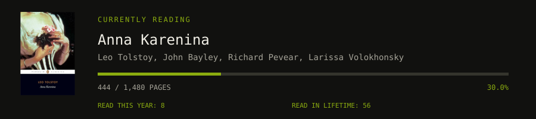
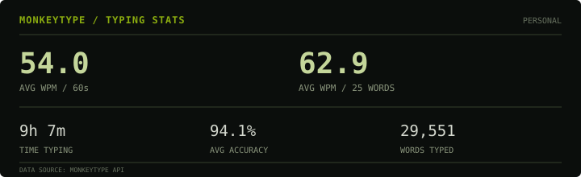

# Tomas Di Leo

## My Setup

<table>
  <tr>
    <td>Linux Distro</td>
    <td></td>
    <td>Fedora Linux 44 </td>
  </tr>
  <tr>
    <td>Keyboard</td>
    <td></td>
    <td> Keychron C2 PRO 8k</td>
    <td><a href="https://github.com/TomasDiLeo/qmk_firmware"> My Firmware </a></td>
  </tr>
  <tr>
    <td>EReader</td>
    <td></td>
    <td>Kindle PW 2021</td>
    <td>Customized with KOReader</td>
  </tr>
  <tr>
    <td>NeoVIM</td>
    <td></td>
    <td><a href="https://github.com/TomasDiLeo/kickstart.nvim"> My Configuration </a></td>
  </tr>
  <!-- <tr>
    <td></td>
    <td></td>
  </tr> -->
</table>

## Personal Projects I Actually use

<table>
  <tr>
    <td></td>
    <td><a href="https://github.com/TomasDiLeo/killersudoku.koplugin"> Killer Sudoku  </a></td>
    <td>KOReader Plugin</td>
  </tr>
  <tr>
    <td></td>
    <td><a href="https://github.com/TomasDiLeo/sumpuzzle.koplugin"> Sum Puzzle </a></td>
    <td>KOReader Plugin</td>
  </tr>
  <tr>
    <td></td>
    <td><a href="https://github.com/TomasDiLeo/lightsout.koplugin"> Lights Out Puzzle </a></td>
    <td>KOReader Plugin</td>
  </tr>
  <tr>
    <td> + </td>
    <td><a href="https://github.com/TomasDiLeo/koreader_pageturner_companion"> KOReader PageTurner Companion </a></td>
    <td>Android Companion App</td>
  </tr>

  <!-- <tr>
    <td></td>
    <td></td>
  </tr> -->
</table>

## My favourite Repositories

|Project|Developer|Description|
|---|---|---|
| [Kompanion](https://github.com/adpa1013/kompanion) | [adpa1013](https://github.com/adpa1013) | Forked from my PageTurner companion app, this fork has more features and will be updated
|[Solitaire Koplugin](https://github.com/Lalocaballero/solitaire.koplugin)|[Lalocaballero](https://github.com/Lalocaballero)|A Solitaire Plugin Game for KoReader I contributed to|
|[SCP to EPUB](https://github.com/lselden/scp-to-epub)|[lselden](https://github.com/lselden)|A tool to generate EPUBs from SCP articles|
|[Linux](https://github.com/torvalds/linux)|[torvalds](https://github.com/torvalds)|Do I need to say anything?|

## MonkeyType Stats

  

## Socials

<table>
  <tr>
    <td></td>
    <td><a href="YOUR_INSTAGRAM_URL">Instagram</a></td>
    <td></td>
    <td><a href="https://tomasdileo.substack.com/">Substack</a></td>
    <td></td>
    <td><a href="mailto:tomasjdle@gmail.com">Email</a></td>
  </tr>
  <!-- <tr>
    <td></td>
    <td></td>
  </tr> -->
</table>